# ios-re-lab

> Reproducible static reverse engineering and ARM64 patch automation for an iOS IPA.

一个以真实 iOS IPA 为样本的静态逆向工程项目。项目记录了从 IPA 清点、Mach-O 与 Swift/Objective-C 元数据解析，到 ARM64 控制流定位、精确补丁生成和重新打包验证的完整过程。

Git 历史只包含分析文档、补丁器和测试代码；已验证的修改版 IPA 单独作为 GitHub Release 资产发布。仓库不包含原始 IPA、解包后的应用、签名材料或其他第三方二进制。

## 项目成果

| 项目 | 结果 |
| --- | --- |
| 输入包体 | 约 95.6 MB IPA，1029 个归档项 |
| 主程序 | 68,633,456 字节 ARM64 Mach-O |
| 加密状态 | `LC_ENCRYPTION_INFO_64.cryptid = 0` |
| 常规展示路径 | 4 个入口 |
| 激励业务路径 | 11 组 load/reward/close/failure 回调 |
| 更新策略路径 | 1 个 `AppVersion.forceUpdate` 分支 |
| 精确指令补丁 | 82 处 |
| 构建验证 | ZIP 完整性、逐文件差异、SHA-256、指令 preimage |
| 运行验证 | 广告、激励业务及强更降级均完成实际安装与真实触发条件验证 |

## 技术栈

- REA：包体清点、证据记录与逆向工作流组织
- Python 3：Mach-O/Objective-C 元数据解析、补丁生成、IPA 重打包
- Capstone：ARM64 指令反汇编与控制流复核
- Mach-O：Load Command、segment/section、代码签名与文件偏移映射
- Swift / Objective-C Runtime：类、方法、ivar 与 Reflection 字段恢复
- ARM64：`B`、`BL`、`TBNZ`、寄存器传参与 ARC 生命周期分析
- SHA-256 / ZIP：目标版本约束、构建完整性与差异验证

## 目录结构

```text
ios-re-lab/
├── README.md
├── CHANGELOG.md
├── SECURITY.md
├── docs/
│   ├── 01-recon.md
│   ├── 02-control-flow.md
│   ├── 03-patch-design.md
│   ├── 04-verification.md
│   └── 05-resume-notes.md
├── src/
│   └── patch_ibox_250.py
└── tests/
    └── test_patcher.py
```

## 分析流程

```mermaid
flowchart LR
    A["IPA artifact"] --> B["Inventory and SHA-256"]
    B --> C["Extract main Mach-O"]
    C --> D["Parse ObjC and Swift metadata"]
    D --> E["Trace ARM64 control flow"]
    E --> F["Design exact instruction patches"]
    F --> G["Verify preimages"]
    G --> H["Rebuild IPA"]
    H --> I["ZIP, hash and diff verification"]
    I --> J["Re-sign and runtime test"]
```



## 核心设计

### 1. 版本绑定

补丁器只接受主程序 SHA-256 与已分析样本完全一致的 IPA。任何版本差异都会立即终止，避免将固定偏移写入未知二进制。

### 2. Preimage 校验

每个补丁包含：

```text
file offset + expected bytes + replacement bytes + description
```

写入前必须先匹配原始指令。即使文件哈希检查被移除，局部 preimage 仍能阻止多数错误写入。

### 3. 复用原业务状态机

激励流程没有简单地把入口改为 `RET`，而是将 didLoad/failure 路径重定向到应用已有的 reward 与 close 回调，从而保留原本的业务解锁、页面恢复和资源释放逻辑。

### 4. 保持 ARC 语义

补丁会调整 `swift_retain`、`swift_release` 和 `swift_bridgeObjectRelease` 的调用关系，确保控制流改变后仍使用正确对象和释放方式，避免仅修改跳转导致引用计数失衡。

### 5. 更新策略降级

`AppVersion.forceUpdate` 的条件分支会跳过取消按钮与取消回调。补丁只移除这条条件跳转，使服务端强制更新按可关闭的普通更新提示执行，不影响配置请求和其他主界面初始化。

## 快速使用

环境要求：Python 3.10 或更高版本，仅使用标准库。

```bash
python src/patch_ibox_250.py input.ipa output.ipa
```

成功后会打印：

- 输入 IPA SHA-256
- 输出 IPA SHA-256
- 所有已应用补丁及文件偏移
- 重新签名提示

输出 IPA 的 Mach-O 代码签名已经失效，安装前必须使用自己的证书和描述文件重新签名。

## Release 构建

已验证的整合构建作为 GitHub Release 资产保存，不写入 Git 历史：

- [v1.0.0 · iBox-2.5.0-patched.ipa](https://github.com/zhj625/ios-re-lab/releases/tag/v1.0.0)
- SHA-256：`fe1387194fc2ad3608a8dd9495b07d56db161e82e542f30a17ca08f6b84f107a`
- 状态：需要重新签名后安装

## 测试

```bash
python -m unittest discover -s tests -v
```

单元测试不需要原始 IPA，覆盖 ARM64 分支编码、对齐/范围检查和版本不匹配拒绝逻辑。针对真实样本的集成验证步骤见 [docs/04-verification.md](docs/04-verification.md)。

## 文档导航

- [侦察与目标画像](docs/01-recon.md)
- [关键控制流恢复](docs/02-control-flow.md)
- [补丁设计与偏移](docs/03-patch-design.md)
- [验证、边界与复现](docs/04-verification.md)
- [简历描述与面试提纲](docs/05-resume-notes.md)

## 边界

该仓库是针对一个固定版本样本的研究记录，不是通用 iOS 补丁框架。固定偏移、类布局和回调地址不能直接迁移到其他版本。静态分析能够证明指令和控制流关系，但不能替代所有运行时场景验证。
